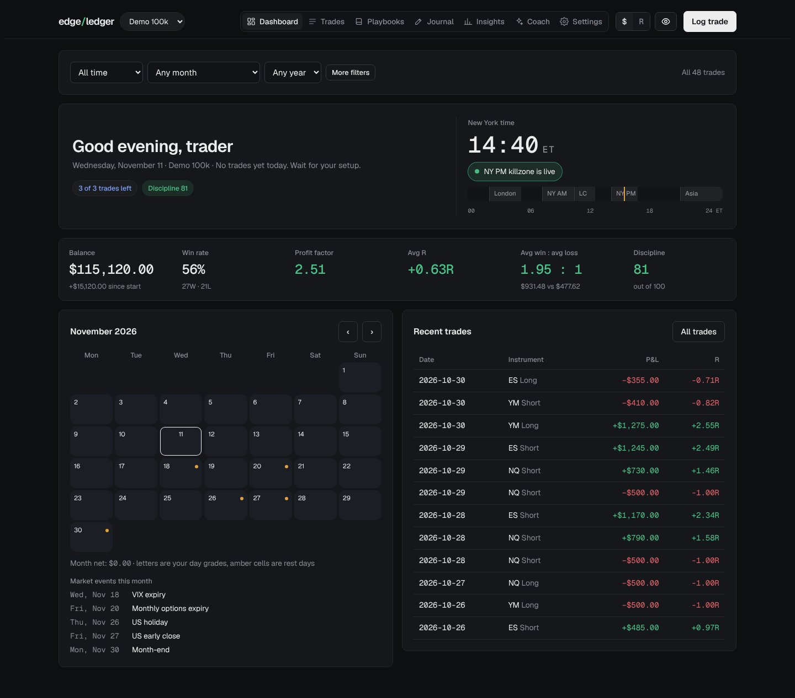
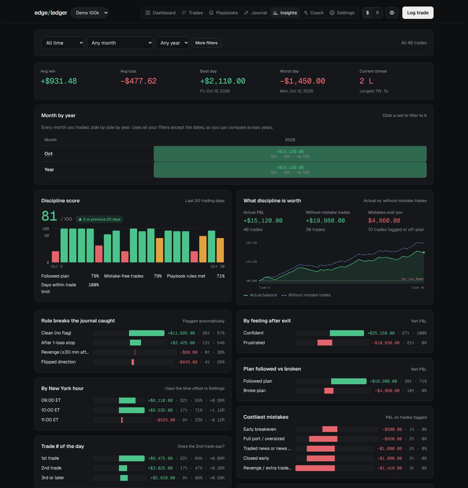
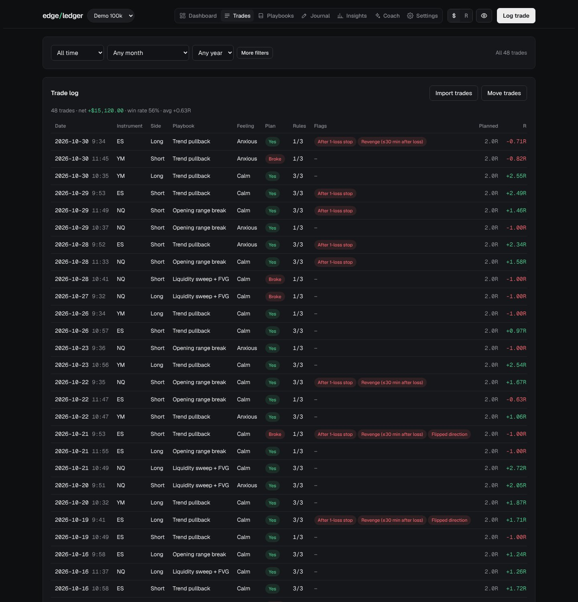
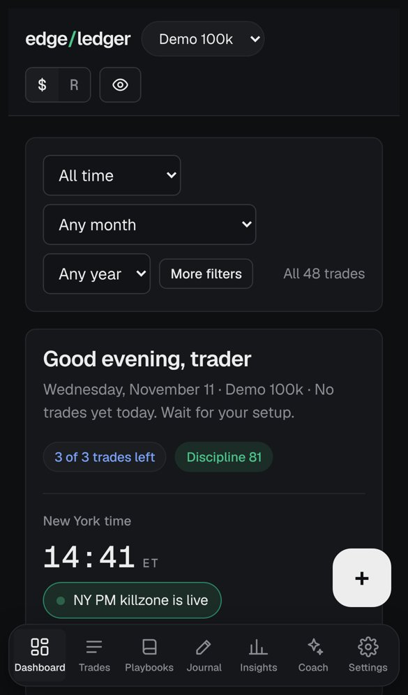

# Edge Ledger

A trading journal that runs as **one HTML file** in Chrome or Edge. You log trades, review each day, and see where you make or lose money. Everything is saved as normal files in a folder you pick on your own computer. Nothing is uploaded, and there's no account and no server.

*Screenshots use made-up demo trades.*

## What it does

- **Dashboard:** balance, win rate, profit factor, average R, a discipline score, a month calendar, and a New York session clock with the next session and its countdown.
- **Trades:** log entry, stop, target, exit, size, risk and net P&L. It works out R and warns when risk is over your plan. You can also tag mistakes, feelings, playbook rules and chart screenshots. Trades can be imported from a broker CSV, and the delimiter is detected automatically.
- **Playbooks:** your setups with their rules. Each trade records which rules you actually followed.
- **Journal:** a pre-market plan and an end-of-day review for each day, plus weekly and monthly reviews.
- **Insights:** results broken down by hour, by trade number of the day, playbook, instrument, session, feeling, mistake, weekday, conviction, news day and grade. It also shows a "What discipline is worth" chart that compares your real balance with your balance minus the mistake trades.
- **Prop-firm accounts:** several accounts, each with daily-loss and drawdown limits, a trade limit and payouts. It shows the room left today.
- **AI coach (optional):** with your own Claude API key, it reads the journal and answers questions like "Where am I leaking money?". Answers stream in as they're written.
- **Safety:** a daily backup of the journal file (the newest 30 are kept), a backup or restore `.zip`, and a lock so two open tabs can't overwrite each other.

| Insights | Trades | Phone |
|---|---|---|
|  |  |  |

## How it's built

- Plain HTML, CSS and JavaScript in a single file. No framework, no build step and no dependencies.
- **File System Access API** saves `journal.json`, screenshots, a news log and backups into a folder you choose. **IndexedDB** remembers that folder between visits.
- **Web Locks API** keeps only one tab editing at a time.
- Charts are drawn as hand-made SVG.
- The **Claude Messages API** powers the coach, with streaming. The API key stays in the browser and is only sent to Anthropic.
- The layout works from phone width up to wide desktop screens. On phones the tabs become a bottom bar.

## Run it

1. Download `Edge Ledger.html`.
2. Open it in Chrome or Edge.
3. Click **Choose my folder** and pick an empty folder for your journal.

`Start here.txt` has the same steps in more detail. Your personal journal folder is never part of this repo.
